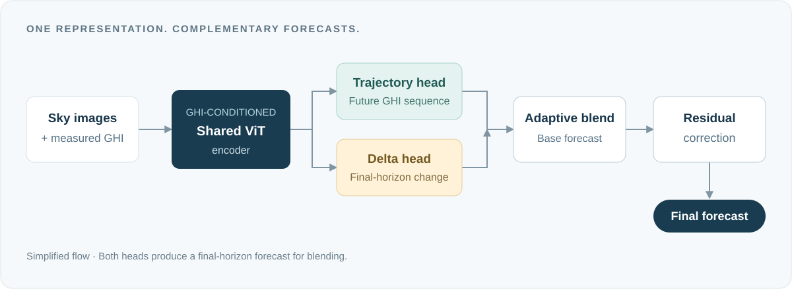

<p align="center">
  
</p>

<h1 align="center">GateFormer</h1>

<p align="center">
  <strong>Forecast-space decomposition for intra-hour solar irradiance prediction from sky images</strong>
</p>

<p align="center">
  <a href="https://github.com/DavidHamlyn">David Hamlyn</a> · Sunny Chaudhary · Jonathon Hare · Tasmiat Rahman<br>
  University of Southampton<br>
  <em>Energy and AI · 2026</em>
</p>

<p align="center">
  <a href="https://doi.org/10.1016/j.egyai.2026.100917"><strong>Read the paper ↗</strong></a>
  &nbsp;·&nbsp;
  <a href="https://davidhamlyn.github.io/GateFormer/">Project page</a>
  &nbsp;·&nbsp;
  <a href="#citation">Citation</a>
  &nbsp;·&nbsp;
  <a href="#code-release">Code release</a>
</p>

<p align="center">
  <a href="https://doi.org/10.1016/j.egyai.2026.100917"></a>
  <a href="https://www.sciencedirect.com/journal/energy-and-ai"></a>
  <a href="#code-release"></a>
</p>

---

## Overview

GateFormer forecasts global horizontal irradiance (GHI) from sky imagery and recent irradiance measurements. A shared, GHI-conditioned Vision Transformer feeds two complementary predictors: one forecasts the future trajectory, while the other predicts change at the final horizon. A learned gate blends their forecasts, followed by a residual correction.

<p align="center">
  
</p>

<p align="center"><sub>Conceptual overview. See the paper for the full architecture and conditioning inputs.</sub></p>

## Results at a glance

| Evaluation | Reported result |
| :--- | :--- |
| NREL-TSI · +30 minutes | **125.01 W/m² RMSE** |
| Comparison with SIAT · paired timestamps | **9.6% lower RMSE** |
| Forecast skill over smart persistence · three sites | **22.97–28.86%** |

Evaluated on **NREL-TSI, Chilbolton, and SIRTA**. Figures are from the [published paper](https://doi.org/10.1016/j.egyai.2026.100917); comparisons follow its evaluation protocol.

## Code release

**Code coming soon.** This repository currently serves as the paper’s project page. The implementation will be added here in a future update.

Star this repository to bookmark the project, or use **Watch → Custom → Releases** to follow future releases.

## Citation

If this work is useful to your research, please cite:

```bibtex
@article{hamlyn2026gateformer,
  title   = {{GateFormer}: Forecast-space decomposition for intra-hour solar irradiance prediction from sky images},
  author  = {Hamlyn, David and Chaudhary, Sunny and Hare, Jonathon and Rahman, Tasmiat},
  journal = {Energy and AI},
  volume  = {26},
  pages   = {100917},
  year    = {2026},
  doi     = {10.1016/j.egyai.2026.100917},
  url     = {https://doi.org/10.1016/j.egyai.2026.100917}
}
```

Download the [BibTeX entry](citation.bib), or use GitHub’s **Cite this repository** button.

## Related research

[Vision Transformers for Estimating Irradiance Using Data-Scarce Sky Images](https://github.com/DavidHamlyn/solar-irradiance-vision-transformer) — our earlier work on solar irradiance estimation, published in *Energy and AI* (2025).
